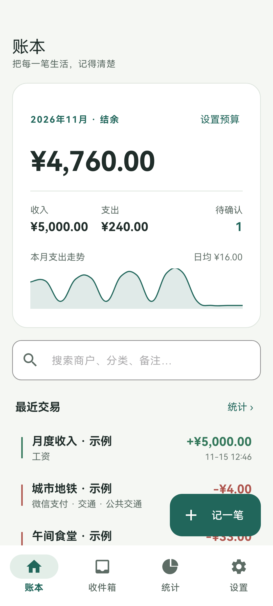
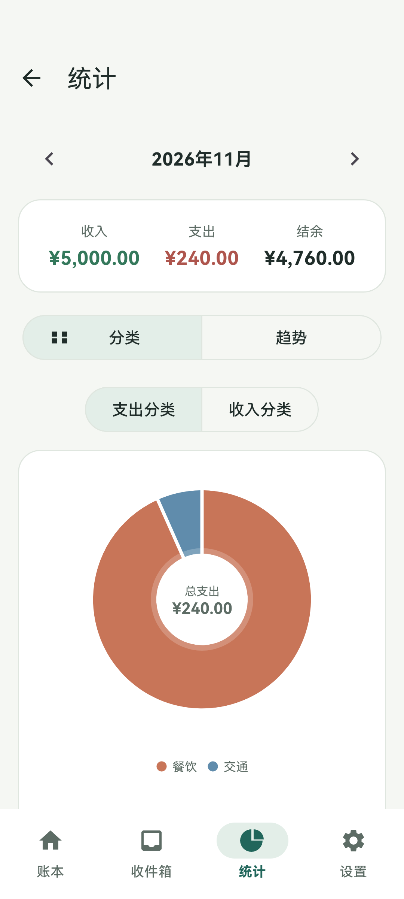
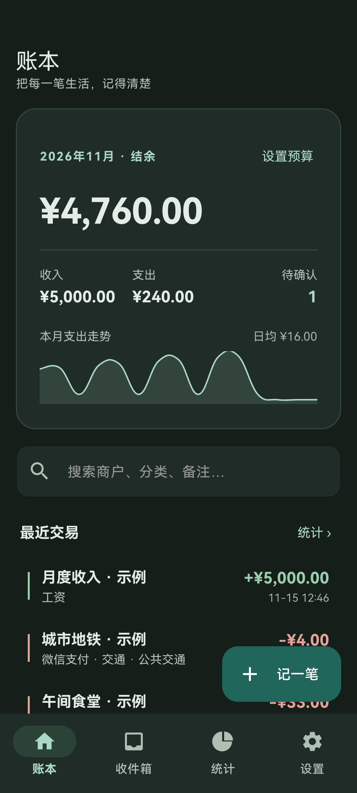
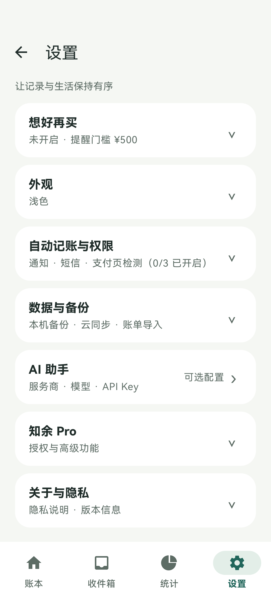
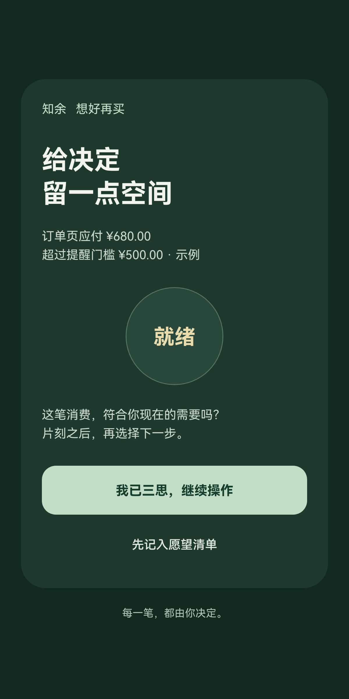

<p align="center">
  
</p>

<h1 align="center">知余</h1>
<p align="center">记清每一笔，也为生活留一点余地。</p>
<p align="center">
  <a href="https://github.com/yuhaoyan04/MoneyTracker/releases/latest">下载 Android 应用</a> ·
  <a href="PRIVACY.md">隐私说明</a> ·
  <a href="https://github.com/yuhaoyan04/MoneyTracker/issues">反馈问题</a>
</p>

知余（原 MoneyTracker）是一款本地优先的 Android 生活账本。支付通知先进入收件箱，确认之后才计入账本；分类建议随你的纠正逐步学习；大额付款前，可以给自己留一点思考的时间。

无需注册即可手动记账、查看统计、管理预算和导出备份。自动采集与付款提醒按需开启，浅色、深色和跟随系统三种外观可选。

<table>
  <tr>
    <td align="center"><br/>清楚记录</td>
    <td align="center"><br/>看见习惯</td>
    <td align="center"><br/>日夜舒适</td>
  </tr>
</table>

> 展示图来自独立测试包中的虚拟账目，不包含真实用户数据。

## 从记录到决定

**收件箱，让自动记账可以核对。** 微信、支付宝、云闪付与已收录银行应用的通知，以及符合规则的银行交易短信，经过来源白名单、交易语义过滤和去重处理后生成候选记录。购物平台广告不作为记账来源。乘车与免密扣款通知也走这条管线，小额交易不会因为付款提醒门槛而被忽略。

**分类按用途，渠道单独记录。** 餐饮、交通、居住、日用、服饰穿搭、个人护理、数码设备等用途与微信、支付宝等支付渠道分开。美妆护肤统一归入个人护理。历史标签和自定义分类保留，旧账目仍可查看与统计。

**逐步学习的分类建议。** 本地引擎结合商户、时间、金额和有效文本给出建议，积累用户确认与纠正，降低反复猜错的信心。含糊的购物平台和单一金额不会被当作商品用途的充分证据。可选云端 AI 分析需要自行配置服务商，与本地分类学习分开。

**想好再买，给大额消费留一步。** 当前重点支持淘宝、京东到微信和支付宝的付款流程。在可识别的确认页或收银台验证金额，只有超过自设门槛才请求冷静提醒；倒计时后可以继续，也可以转入愿望清单。部分淘宝路径采用付款按钮前的提醒。其它购物应用与独立银行付款入口暂不作为已验收范围。

**分析有图，也有明细。** 月度收支、分类环图与下钻明细、趋势和时段分布、预算进度、月报导出，帮助回顾消费去向。金额、比例和文本共同表达结果，避免仅靠颜色理解图表。

## 简洁，也保留掌控

<table>
  <tr>
    <td align="center"><br/>设置按用途整理</td>
    <td align="center"><br/>每一笔，都由你决定</td>
  </tr>
</table>

- 手动录入、修改、回收站与账单文件导入，作为自动采集之外的补充。
- JSON 版本化备份保留交易、分类、渠道、愿望清单及变更历史；旧式独立账本使用 ZIP 备份。两类数据分别导出，恢复时按稳定身份合并。
- 系统文件选择器导入、导出，支持 CSV 交易清单；本地备份仍保留 `Download/SmartLedger` 目录，便于兼容旧版本。
- 识别诊断可以手动开始、停止、复制和保存文件，方便按证据定位问题。

## 开始使用

1. 从 [最新 Release](https://github.com/yuhaoyan04/MoneyTracker/releases/latest) 下载 APK。已有 MoneyTracker 可直接覆盖升级；升级前建议导出 JSON，使用过旧式独立账本时再导出 ZIP。应用包名和数据目录保持兼容。
2. 先记一笔，或在「设置 → 自动记账与权限」按需开启通知、短信权限。通知未送达、未包含金额或模板无法识别时，需要导入账单或手动补记。
3. 使用付款提醒时，在「设置 → 想好再买」设置门槛和时长，按说明开启守护服务及相关权限；屏幕识别实验选项在「识别选项与检测自检」内单独开启。
4. 在收件箱核对交易与分类，再确认入账。定期导出一份手机之外的备份。

华为等设备还可能需要在系统启动管理中允许后台活动。应用不会代你输入支付密码或执行付款，也不能保证覆盖每一种付款页面。安全窗口、页面改版、通知关闭、系统后台限制与应用锁都会影响识别。支付宝识别可能需要等待画面稳定后才出现提醒，不能替代用户自己的付款确认。

## 验证与技术

项目使用 Kotlin、原生 Android Views、Material Components、Room、WorkManager 与设备端 ML Kit OCR，最低 Android 7.0。无障碍截图能力取决于系统版本，完整付款识别需要相应系统支持。

淘宝／京东 × 微信／支付宝的实机验证范围及证据见 [付款验收记录](validation/payment-acceptance-2.45.7.json)；新品牌版本的检查结果见 [v2.46.0 验收记录](validation/acceptance-2.46.0.json)。记录明确区分测试版本、观察结果和未覆盖范围，不表示所有设备与未来支付页面都已验证。

```powershell
# JDK 17；Android SDK 36
.\gradlew.bat :app:testDebugUnitTest :app:assembleRelease

# 独立设备测试包，避免使用个人账本
.\gradlew.bat :app:assembleDebug :app:assembleDebugAndroidTest -PisolatedDeviceTest=true
```

发布签名由未入库的 `keystore.properties` 配置；未配置时使用调试签名，无法覆盖安装官方签名版本。API Key、签名文件和本机配置不得提交。设计约定及标志生成方式见 [设计文档](docs/DESIGN.md)，采集与备份边界见 [架构说明](docs/CAPTURE_AND_BACKUP_ARCHITECTURE.md)。

## 许可与反馈

本项目采用 [CC BY-NC 4.0](LICENSE)：允许署名后的非商业分享与修改，商业使用需另行授权。

提交问题时请附应用版本、系统版本、复现步骤与脱敏诊断。请勿上传支付密码、账号、卡号或包含个人信息的截图。

商业授权与联系：yizhilaotian@gmail.com
